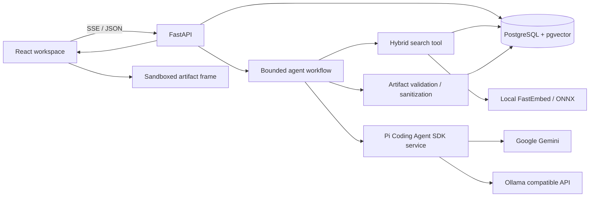

# Architecture

## Runtime boundaries

FastAPI owns data access and controlled tool orchestration. The React client owns presentation, explicit provider choice, progress and artifact viewing. Grounded drafts are withheld until format and source checks complete. PostgreSQL is the durable system of record. Local models and embeddings are separate lifecycles. No Redis, vector service, model-controlled shell, external web search or multi-agent subsystem is needed.

## Schema and isolation

Frontend initialization reads the session list and readiness with a ten-second deadline and a recoverable branded loading state. Role alignment does not change message order or the stream contract. Mobile navigation contains focus; evidence/artifact panels restore focus on dismissal. Local SVG assets and CSS motion use the existing component stack, and HTML preview permissions remain unchanged. Fixture-based browser coverage and live-verification limits are summarized in the implementation status.

`users` stores anonymous user metadata and creation time. Each `sessions` row references its local user record and stores title/creation/update timestamps. `messages` has role, content, provider/model, created time and metadata including completion state and cited evidence snapshots. `sources` stores episode provenance and content hash. `chunks` stores source ID, chunk order, content/hash, 384-dimensional vector, tsvector and pipeline metadata. `artifacts` references its session and assistant message and stores type/title/content, source IDs, evidence snapshots and word count.

Session/message/artifact IDs are UUIDs. Foreign keys cascade conversation deletion to messages and artifacts. A unique constraint protects `(source_id, chunk_index)`; source paths are unique. HNSW cosine and GIN full-text indexes support retrieval. An insert/update trigger maintains the tsvector.

Each request explicitly scopes history to the supplied session ID. The browser remembers the active session ID locally and reopens its persisted detail after a reload; there is no cross-session model memory. A session advisory lock rejects overlapping turns and prevents deleting a conversation while it is generating. The SDK does not resume its own history. The system is single-user: IDs are not an authorization mechanism and cannot replace authentication if deployed to a shared/public host.

## Retrieval and grounding

The `all` ingestion profile fetches `TRANSCRIPT_REPOSITORY` at `TRANSCRIPT_REVISION`; the `demo` profile fetches only paths declared in the configurable metadata-only `DEMO_SOURCES_FILE` manifest. Demo metadata includes source license and attribution, while transcript text remains an external runtime input rather than a repository fixture. The manifest does not accept excerpt or transcript fields. YAML frontmatter supplies metadata for the full archive; the demo manifest supplies it for its declared sources. Hash, chunking and metadata-version checks skip unchanged files. Metadata-only upgrades retain existing source/chunk UUIDs and vectors. Full text changes replace chunks atomically. Old message citations preserve the original passage, metadata and revision.

Generic integrity checks compare the declared guest, recurring transcript speakers and the archive title's explicit interviewee suffix. Conflicts retain original metadata, mark date/title/video unverified, and link to the immutable transcript. Speaker names/timestamps are extracted from actual labels, never inferred by a model. The checks cannot authenticate a video's content or independently verify publication dates. `scripts/audit_metadata.py` audits every indexed source.

When a chunk starts mid-speech, its opening speaker comes from the preceding explicit label in the full transcript. This context accompanies the unchanged excerpt in both generation and support review. A failed positional match leaves the speaker unknown. Speaker parsing requires the name and timestamp on the same line, so an unlabeled timestamp cannot turn the previous sentence into a speaker name.

Output-format wording and trailing artifact instructions are removed from artifact retrieval queries. When a request explicitly names indexed guests, retrieval is scoped to their interviews and their already-applied names are removed from the embedding query. A single named interview can supply the full evidence budget; broad/comparative queries retain a two-chunk-per-episode diversity cap. Standalone knowledge/writing requests omit unrelated prior conversation from generation; contextual follow-ups retain bounded history.

The topic query is embedded locally. Semantic search and PostgreSQL web-search full-text matching each propose up to 40 candidates. Reciprocal-rank fusion uses `1/(60+rank)` contributions. A cosine floor is computed for every candidate, including lexical-only matches; `RAG_TOP_K` total enter generation. The score is a ranking aid, not a probability of factual correctness. Full-sentence lexical search can be conservative; vector retrieval supplies paraphrase coverage.

Pronoun follow-ups include the previous two relevant user topics within a strict budget; a new explicit topic starts a new search. Generation gets at most eight historical messages, 8,000 characters total, 4,000 per message. A separate session-scoped registry loads saved evidence snapshots independently of that history window. Labels `[S1]` etc. remain attached to `(chunk_id, revision)` across turns; newly encountered chunks receive new labels. Legacy conversations that reused labels resolve to their most recent displayed meaning. Explicit S3 requests use the saved S3 passage without substituting a fresh retrieval result. Quote and metadata inspection is deterministic and does not claim model authorship.

Retrieved text is marked as data, not instructions. No usable evidence means abstention. Sources attached to an accepted answer contain only its cited passages. A withheld draft may retain the inspected evidence so the user can inspect it without treating the rejected claims as facts.

Citation allowlisting proves identifier validity, not entailment. Exact quotation spans are checked against excerpts. Clearly introduced interview questions in labelled Markdown proposed-application sections are original suggestions, not alleged source quotations; quoted factual statements and source-attributed wording still require matching spans. This exemption changes only the quotation check's input, never the draft. A separate bounded call to the selected provider reviews the entire draft's factual support, speaker attribution, scope, numbers and citation associations using only its cited passages; malformed/uncertain verdicts fail closed. Faithful paraphrases and clearly labelled proposed applications are allowed. Rejected claims receive one repair, then the app abstains if still unsupported. The same model can make correlated mistakes or over-abstain; this is an assessment, not proof. `scripts/evaluate_grounding.py` measures labelled supported/unsupported cases separately from retrieval and structural validation.

A narrow numerical check rejects percentages absent from the paragraph's cited passages and percentage/metric pairs not defined there. It catches uncited numerical examples and some errors such as relabelling a survey score as an adoption rate; it does not validate all arithmetic or semantic claims. Citation lists such as `[S1, S2]` are normalized into individual evidence anchors without inventing IDs.

## Agent and provider design

Application tools: `search_knowledge_base`, long-form growth essay drafting/validation, and sanitized HTML generation. Lightweight routing distinguishes conversation, knowledge, saved quotes/metadata, follow-ups, writing and requested artifact formats. Explicit no-search, exact-output and conversation-history recall constraints take precedence over retrieval. Conversation uses a neutral instruction prompt; explicit history-recall requests use only the current session's bounded history and never substitute transcript facts. Exact requests omit unrelated history and validate the literal output. Essay instructions load from the configurable `SHIP30_GUIDE_FILE`; the default guide is independently authored for this project. Each request searches at most once and drafts at most twice, with at most one source review per draft (four model calls maximum). The repair receives specific defects. Length/bullets/emphasis-only essay repairs can insert one additional section, then revalidate the entire essay. Calls have timeouts and output bounds.

A request for both formats produces one checked Markdown document and a deterministic, sanitized standalone HTML rendering. Two separate artifact records share the assistant message and evidence, with distinct IDs, payloads and downloads. `artifact_ids` preserves both cards after refresh; the singular legacy field remains readable.

Explicit no-search artifacts without saved-source references are original writing: they do not inherit the evidence registry, require podcast citations or undergo transcript entailment review. They still pass format/title/list constraints and sanitization; fabricated S-citations are rejected. Source-based writing retains full grounding. Fresh metadata/raw-evidence requests return retrieved fields and unchanged excerpts directly. Conditional user-specified absence sentences are accepted before citation validation, not mistaken for unconditional exact-output tasks.

Per-turn diagnostics record mode, grounding requirement, citation/chunk IDs, excerpt hashes and failed check categories without raw conversation text. Optional isolated QA captures fixed regression drafts/evidence only when explicitly requested and stores them under ignored `.runtime`; it does not intercept application traffic. Verification status and limits are summarized in the implementation status.

Every draft, source review and repair generation passes through the Pi Coding Agent SDK service. The service selects exactly the requested Google Gemini or Ollama model, creates an in-memory `AgentSession`, calls `session.prompt`, and streams Pi `text_delta` events back to FastAPI over private NDJSON. It uses an isolated resource loader and session manager, disables every Pi tool (`tools: []`, `noTools: "all"`), and disables automatic SDK retries. Python remains responsible for routing, retrieval, evidence assembly, citation and grounding checks, persistence, and sanitized artifacts. Provider selection never silently falls back.

Gemini is the explicit cloud provider through Pi's Google provider. Ollama is selected through Pi's OpenAI-compatible endpoint configuration. The app never fails over automatically across the local/cloud privacy boundary.

Gemini without a key is unavailable. Configured credentials receive a cached authenticated model-access check; this is labelled separately from successful generation and does not produce a green runtime badge. Pi bridge errors classify authentication, quota/rate, missing model, timeout and connectivity failures without exposing raw SDK errors. Ollama readiness confirms a reachable server and installed model. Saved source inspection has no provider/model attribution.

## Stream lifecycle and failure behavior

Validate request → confirm session → acquire advisory lock → persist user input → route → optional retrieval → progress during generation → validate/review/repair → atomically persist assistant and artifacts → emit final message and artifacts. Failed and stopped requests have visible completion metadata and do not enter future history. Unverified partial drafts are never presented as answers.

`POST /api/chat/stream` emits `accepted/status/delta/reset/sources/artifact/done/error`. The client replaces provisional content with `done.message`. HTML and essay generation report progress while composing; they appear only after validation. An aborted browser fetch closes generation; the provider context manager unwinds and the session lock is released. Connection pooling and an explicit rollback avoid holding the initial read transaction for the duration of the stream.

Structured errors distinguish invalid requests, missing sessions, busy sessions, missing models/keys, provider connectivity, timeout, validation failure and database failure. Model and artifact output are never returned as a traceback. Liveness is independent of the database; readiness checks schema/vector/corpus and provider configuration separately.

## Artifact trust boundary

Markdown renders through React Markdown with raw HTML disabled; images are omitted and evidence links are application-owned buttons. The model cannot supply navigable external URLs through Markdown.

HTML is parsed server-side, removes scripts, handlers, embedded frames, forms, SVG/MathML, external assets, active controls and external navigation. CSS is limited to presentation properties; all at-rules, URL functions, escapes and expression syntax are removed. Client DOMPurify repeats sanitization. The `srcdoc` iframe has `sandbox=""` (no script, origin, forms, popups, downloads or navigation permissions). Its CSP defaults to no resources and permits inline CSS only. Preview sources are shown outside the frame. Download exports the already-sanitized document with its CSP.

Allowed: semantic text/sections/tables, safe layout and typography, fragment anchors. Blocked: generated JavaScript, network assets, forms, nested frames, parent DOM access and external navigation. CSS may still produce poor visual layout inside its isolated frame; safety checks are not a guarantee of attractive output.

## Operations and extension points

Compose runs native PostgreSQL/pgvector, Ollama, a one-shot model pull, a non-root FastAPI container, one-shot corpus indexing and nginx serving compiled React with unbuffered SSE proxying. Named volumes preserve all state. Host bindings are loopback. API keys stay server-side and are not built into frontend assets.

For GPU deployment, configure the runtime appropriate to the host or use native Ollama with an explicit URL override. Use a dedicated DB and run Alembic before ingestion. Keep schema migrations immutable. Add provider implementations behind `generate`, add output modes behind validation, and extend metadata without changing citation semantics. Avoid transaction-mode connection poolers because the application uses session advisory locks.

The optional PGlite harness uses a real PostgreSQL WASM engine with pgvector, but multiplexes a single backend. It supports local functional checks; it does not establish native PostgreSQL concurrency, crash recovery or Compose operability. Those checks are separately represented in CI and implementation status.
